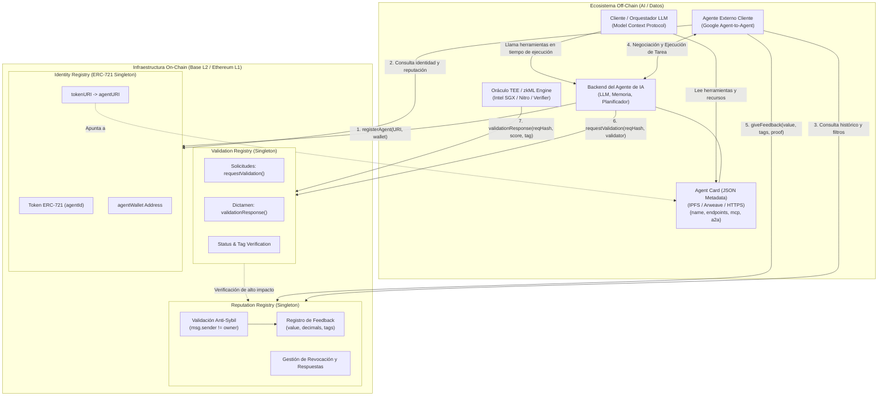
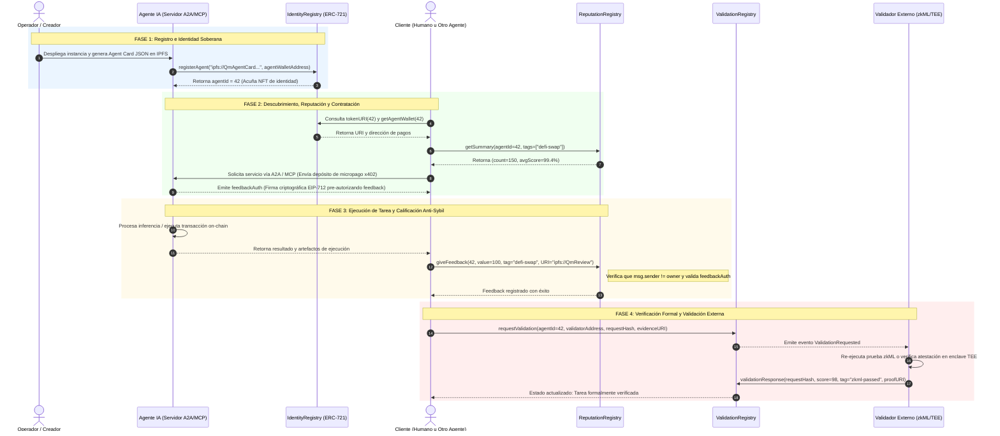

# Especificación Exhaustiva y Guía Arquitectónica: ERC-8004 ('Trustless Agents')
### Estándar Universal de Identidad, Reputación y Validación para Agentes de Inteligencia Artificial en Ethereum y Base

---

## 1. Introducción y Antecedentes

### 1.1 El Nacimiento de la Economía de Agentes Autónomos
El avance exponencial de los Modelos de Lenguaje Grande (LLMs) y los sistemas de razonamiento autónomo ha transformado a los agentes de software de simples bots reactivos a **actores económicos soberanos**. Un agente de inteligencia artificial actual no solo genera texto o procesa información; tiene la capacidad de:
* Mantener objetivos a largo plazo y planificar estrategias complejas de ejecución.
* Gestionar balances criptográficos y tesorerías descentralizadas de forma no custodial.
* Invocar herramientas externas y llamar a interfaces de programación (APIs/smart contracts).
* Negociar y contratar servicios con otros agentes de manera autónoma.

Sin embargo, a medida que los agentes salieron de los entornos de laboratorio aislados para interactuar en la web abierta y en redes blockchain, surgió un cuello de botella crítico: **el problema de la confianza y la fragmentación arquitectónica**.

```
                   +------------------------------------------------+
                   |           AGENTE DE IA AUTÓNOMO                |
                   | (Razonamiento, Planificación, Ejecución)       |
                   +-----------------------+------------------------+
                                           |
         +---------------------------------+---------------------------------+
         |                                 |                                 |
         v                                 v                                 v
+------------------+             +-------------------+             +------------------+
| ¿Quién es?       |             | ¿Cómo se ha       |             | ¿Quién valida    |
| IDENTIDAD        |             | comportado?       |             | su trabajo?      |
| Criptográfica    |             | REPUTACIÓN        |             | VERIFICACIÓN     |
| y Portabilidad   |             | Anti-Sybil        |             | zkML / TEE       |
+------------------+             +-------------------+             +------------------+
```

### 1.2 El Problema Fundamental del "Trust" y la Fragmentación
Hasta la concepción de **ERC-8004**, la infraestructura para agentes de software sufría de tres carencias determinantes:

1. **Inexistencia de Identidad Canónica y Censorship-Resistant:**
   Los agentes dependían de cuentas centralizadas (claves de API propietarias de OpenAI, Google Cloud, servidores Web2 o dominios DNS tradicionales). Si un proveedor Web2 suspendía la cuenta, la identidad, historial y fondos del agente quedaban secuestrados o eliminados.

2. **Déficit de Confianza Inter-Agente (Counterparty Risk):**
   Protocolos emergentes como **Anthropic Model Context Protocol (MCP)** o **Google Agent-to-Agent (A2A)** definieron cómo los agentes intercambian mensajes y herramientas, pero **no** si la contraparte es legítima, maliciosa o competente. Si el Agente $A$ desea contratar al Agente $B$ para ejecutar una orden de arbitraje en una DEX, ¿cómo sabe $A$ que $B$ no se fugará con los fondos o no alucinará una ejecución inexistente?

3. **Incompatibilidad de Mecanismos de Evaluación y Spam (Sybil Attacks):**
   Sin un registro de reputación universal respaldado por consenso criptográfico, cualquier entidad maliciosa podía generar miles de agentes títere para inflar puntuaciones artificiales o realizar ataques de denegación de servicio.

### 1.3 Los Autores y la Alianza Cross-Industry
Para resolver esta deficiencia de infraestructura fundacional, en agosto de 2025 se presentó formalmente la propuesta **ERC-8004** bajo el título **"Trustless Agents"** ([Ethereum Magicians Thread #25098](https://ethereum-magicians.org/t/erc-8004-trustless-agents/25098) y PR en `ethereum/ERCs/pull/1170`). 

La especificación fue diseñada por un equipo multidisciplinar que agrupa a los principales líderes de infraestructura de monederos Web3, investigación criptográfica, gigantes de inteligencia artificial e infraestructura Layer 2:

* **Marco De Rossi** – *MetaMask / Consensys*: Especialista en experiencia de usuario web3, gestión de claves y estándares de billeteras descentralizadas.
* **Davide Crapis** – *Ethereum Foundation*: Investigador en Robust Incentives Group (RIG) de la Fundación Ethereum, enfocado en teoría de juegos, economía de agentes y consenso.
* **Jordan Ellis** – *Google*: Arquitecto enfocado en interoperabilidad de inteligencia artificial y protocolos multi-agente (A2A).
* **Erik Reppel** – *Coinbase*: Ingeniero de Coinbase Developer Platform (CDP), creador clave en iniciativas de Coinbase AgentKit y adopción de agentes en Base L2.

Esta convergencia histórica garantiza que ERC-8004 no sea un estándar de juguete o puramente experimental, sino una **especificación de nivel industrial** adoptada tanto por la infraestructura de clientes Web2/AI (Google, Anthropic) como por la infraestructura de liquidación descentralizada Web3 (MetaMask, Ethereum Foundation, Coinbase).

---

## 2. Arquitectura de los Tres Registros Singleton

ERC-8004 establece una arquitectura desacoplada y modular compuesta por **tres contratos singleton** desplegados por red. Este diseño respeta el principio de separación de responsabilidades: separa la identidad del agente, su historial de comportamiento y las pruebas criptográficas de sus ejecuciones.

```
       +-------------------------------------------------------------------------+
       |                           ECOSISTEMA ERC-8004                           |
       +-------------------------------------------------------------------------+
                                            |
         +----------------------------------+----------------------------------+
         |                                  |                                  |
         v                                  v                                  v
+-----------------------+        +-----------------------+        +-----------------------+
|   IDENTITY REGISTRY   |        |  REPUTATION REGISTRY  |        |  VALIDATION REGISTRY  |
|  (ERC-721 Singleton)  |        |   (Metrics & Tags)    |        |   (zkML, TEEs, AVS)   |
+-----------------------+        +-----------------------+        +-----------------------+
| * agentId (TokenID)   |        | * giveFeedback()      |        | * requestValidation() |
| * agentURI -> JSON    |        | * value / decimals    |        | * validationResponse()|
| * agentWallet address |        | * feedbackHash/URI    |        | * response status/tag |
| * owner / transfer    |        | * anti-sybil checks   |        | * cryptographic proof |
+-----------------------+        +-----------------------+        +-----------------------+
```

---

### 2.1 Identity Registry (Registro de Identidad)

#### 2.1.1 Fundamento ERC-721 y `agentId`
El **Identity Registry** implementa y extiende el estándar **ERC-721** (Non-Fungible Token). Cada agente autónomo está representado en la blockchain por un `agentId` único (un número entero de 256 bits):

* **Propiedad y Transferibilidad:** El propietario del token ERC-721 (`ownerOf(agentId)`) es la entidad (humana, multisig o Smart Contract Account) con autoridad soberana sobre el agente. La propiedad puede transferirse o depositarse en contratos de custodia/escrow.
* **Inmutabilidad y Portabilidad:** Ningún tercero puede revocar o confiscar el identificador del agente, garantizando resistencia a la censura.
* **`agentWallet`:** El agente puede designar una dirección de billetera operativa (`agentWallet`) diferente a la cuenta del propietario. Esta dirección es utilizada por el agente para firmar peticiones en tiempo de ejecución, recibir pagos directos y ejecutar transacciones sin comprometer la propiedad del NFT.

#### 2.1.2 Métodos Principales de `IERC8004Identity`
```solidity
// SPDX-License-Identifier: MIT
pragma solidity ^0.8.20;

import "@openzeppelin/contracts/token/ERC721/IERC721.sol";

interface IERC8004Identity is IERC721 {
    event AgentRegistered(
        uint256 indexed agentId,
        address indexed owner,
        address indexed agentAddress,
        string agentURI
    );

    event AgentAddressUpdated(
        uint256 indexed agentId,
        address indexed oldAgentAddress,
        address indexed newAgentAddress
    );

    event AgentURIUpdated(
        uint256 indexed agentId,
        string oldURI,
        string newURI
    );

    /// @notice Registra un nuevo agente de IA y acuña un identificador ERC-721
    /// @param agentURI Puntero (IPFS/HTTPS) hacia el archivo de Agent Card JSON
    /// @param agentAddress Dirección operativa asociada para firmas y pagos
    /// @return agentId El identificador único recién asignado
    function registerAgent(string calldata agentURI, address agentAddress) external returns (uint256 agentId);

    /// @notice Actualiza el URI de metadatos del agente (solo invocable por el propietario o gestor autorizado)
    function setAgentURI(uint256 agentId, string calldata newURI) external;

    /// @notice Actualiza la dirección operativa del agente
    function setAgentAddress(uint256 agentId, address newAgentAddress) external;

    /// @notice Obtiene la dirección operativa del agente
    function getAgentAddress(uint256 agentId) external view returns (address);

    /// @notice Retorna el número total de agentes registrados
    function totalAgents() external view returns (uint256);

    /// @notice Retorna si un agentId dado existe
    function agentExists(uint256 agentId) external view returns (bool);
}
```

---

### 2.2 Reputation Registry (Registro de Reputación)

El **Reputation Registry** actúa como un libro contable inmutable de evaluación de desempeño. Permite que usuarios humanos u otros agentes registren retroalimentación estructurada luego de una interacción o prestación de servicios.

#### 2.2.1 El Formato Estructurado de Feedback
En lugar de almacenar texto no estructurado en el estado de la EVM (lo cual incrementaría drásticamente el consumo de gas y dificultaría el cálculo en cadena), el registro maneja métricas compactas:

* **`value` e `valueDecimals`:** Un número entero con signo en formato punto fijo (`int128`). Por ejemplo, una puntuación de éxito de $99.85\%$ se almacena como `value = 9985` con `valueDecimals = 2`. Una tasa de latencia de $340\text{ ms}$ puede registrarse como `value = 340`, `valueDecimals = 0`.
* **`tag1` y `tag2`:** Cadenas de caracteres de indexación corta para categorizar la naturaleza de la métrica (ej. `"latency"`, `"uptime"`, `"defi-swap"`, `"code-audit"`).
* **`endpoint`:** El URI o identificador de ruta específico donde se consumió el servicio.
* **`feedbackURI` y `feedbackHash`:** Puntero hacia un informe detallado off-chain (ejemplo en IPFS o Arweave) junto a su digest criptográfico `keccak256`, garantizando que las evidencias adjuntas no puedan ser alteradas a posteriori.

#### 2.2.2 Mecanismos de Prevención Sybil y `feedbackAuth`
Uno de los mayores retos en los sistemas de reputación descentralizada es el riesgo de que el creador de un agente emita transacciones ficticias para autocalificarse positivamente (falsa reputación) o sabotee a competidores (ataques de difamación).

ERC-8004 mitiga esto a través de tres barreras complementarias:

1. **Rechazo de Auto-Calificación en Smart Contract:**
   El registro consulta directamente al `IdentityRegistry`. Si `msg.sender == ownerOf(agentId)` o `msg.sender == agentWallet`, la transacción revierte de forma obligatoria con el error `UnauthorizedSelfFeedback()`.

2. **Esquema Criptográfico `feedbackAuth` (Pre-Autorización Firmada):**
   Para garantizar que un cliente solo pueda calificar si existió una contratación real, el agente emite al inicio del servicio una autorización criptográfica firmada con su clave privada (vía EIP-191 o EIP-712):
   $$\text{feedbackAuth} = \text{Sign}_{K_{\text{agent}}}\Big(\text{hash}(\text{clientAddress}, \text{agentId}, \text{sessionNonce}, \text{deadline})\Big)$$
   El cliente presenta esta firma al momento de ejecutar `giveFeedback`. De esta forma, un actor malicioso no puede llenar de spam a un agente si este nunca le proporcionó un servicio ni le autorizó una sesión.

3. **Arquitectura Desacoplada de Agregación (Pluggable Reputation Engines):**
   El contrato no impone una única fórmula monopolística de "karma" o "reputación general". Almacena eventos y puntos de datos primitivos. Cualquier cliente o protocolo DeFi puede configurar su propio algoritmo de confianza:
   * Ponderar feedback únicamente de clientes con un volumen transaccional verificado.
   * Exigir que el feedback esté vinculado a una transferencia en el protocolo de pagos `x402`.
   * Descartar calificaciones de cuentas con escasa antigüedad on-chain.

#### 2.2.3 Métodos Principales de `IERC8004Reputation`
```solidity
// SPDX-License-Identifier: MIT
pragma solidity ^0.8.20;

interface IERC8004Reputation {
    struct Feedback {
        address client;
        uint8 score;
        bytes32 tag1;
        bytes32 tag2;
        string feedbackURI;
        bytes32 fileHash;
        uint256 timestamp;
        bool revoked;
    }

    event FeedbackGiven(
        uint256 indexed agentId,
        address indexed client,
        uint8 score,
        bytes32 tag1,
        bytes32 tag2,
        string feedbackURI,
        bytes32 fileHash,
        uint256 feedbackIndex
    );

    event FeedbackRevoked(
        uint256 indexed agentId,
        address indexed client,
        uint256 feedbackIndex
    );

    /// @notice Registra retroalimentación para un agente específico con pre-autorización criptográfica feedbackAuth
    function giveFeedback(
        uint256 agentId,
        uint8 score,
        bytes32 tag1,
        bytes32 tag2,
        string calldata feedbackURI,
        bytes32 fileHash,
        bytes calldata feedbackAuth
    ) external;

    /// @notice Permite al emisor revocar un feedback previamente enviado
    function revokeFeedback(uint256 agentId, uint256 feedbackIndex) external;

    /// @notice Retorna el total de feedbacks para un agente
    function getFeedbackCount(uint256 agentId) external view returns (uint256);

    /// @notice Obtiene los detalles de un feedback específico
    function getFeedback(uint256 agentId, uint256 index) external view returns (Feedback memory);

    /// @notice Retorna la puntuación promedio de los feedbacks activos (0-100)
    function getAverageScore(uint256 agentId) external view returns (uint256);
}
```

---

### 2.3 Validation Registry (Registro de Validación)

En transacciones de alto valor económico (ej. rebalancear $5,000,000 USD en pools de liquidez o sintetizar diagnósticos médicos automatizados), la reputación subjetiva no es suficiente: **se exige verificación matemática y criptográfica de la ejecución**.

El **Validation Registry** es un marco desacoplado de validación independiente que soporta un modelo asíncrono de dos etapas: **Solicitud (`requestValidation`)** $\rightarrow$ **Respuesta (`validationResponse`)**.

```
+--------------------+                               +-----------------------+                               +--------------------+
|  SOLICITANTE       |                               |  VALIDATION REGISTRY  |                               |     VALIDADOR      |
|  (Agente/Cliente)  |                               |      (Singleton)      |                               | (zkML / TEE / AVS) |
+---------+----------+                               +-----------+-----------+                               +---------+----------+
          |                                                      |                                                     |
          |  1. requestValidation(agentId, validator, reqHash)  |                                                     |
          |----------------------------------------------------->|                                                     |
          |                                                      |  2. Emisión de Evento: ValidationRequested          |
          |                                                      |---------------------------------------------------->|
          |                                                      |                                                     | (Inspecciona logs,
          |                                                      |                                                     |  valida prueba o
          |                                                      |                                                     |  atestación)
          |                                                      |  3. validationResponse(reqHash, score, tag, proof)  |
          |                                                      |<----------------------------------------------------|
          |                                                      |                                                     |
          |  4. Consulta status / verificación en smart contract |                                                     |
          |<-----------------------------------------------------|                                                     |
```

#### 2.3.1 Modelos de Confianza Soportados (Trust Backends)
El registro es agnóstico al mecanismo de verificación subyacente. Puede albergar:

1. **Zero-Knowledge Machine Learning (zkML):**
   * El agente ejecuta una inferencia con un modelo (ej. red neuronal de detección de fraudes) y genera una prueba de conocimiento cero (STARK o SNARK tipo Groth16/Plonk).
   * El validador (o un smart contract verifier) constata on-chain que la inferencia fue calculada exactamente sobre la arquitectura y pesos del modelo declarado sin adulteración de datos.

2. **Trusted Execution Environments (TEEs):**
   * El código del agente se ejecuta dentro de un enclave de hardware aislado y seguro (Intel SGX, AWS Nitro Enclaves, Apple SE o AMD SEV).
   * El chip emite una atestación criptográfica remota (*Remote Attestation Quote*) firmada por el fabricante del procesador, certificando que el binario ejecutado coincide exactamente con el hash del código auditado.

3. **Crypto-Economic Restaking y Actively Validated Services (AVS):**
   * Redes de validadores con capital bloqueado (ej. EigenLayer o Symbiotic) re-ejecutan la tarea en paralelo de forma optimista.
   * Si un validador detecta una ejecución fraudulenta, somete una prueba de fraude y el agente/validador culpable sufre *slashing* (confiscación de su colateral).

#### 2.3.2 Métodos Principales de `IERC8004Validation`
```solidity
// SPDX-License-Identifier: MIT
pragma solidity ^0.8.20;

interface IERC8004Validation {
    struct Validation {
        bytes32 validationId;
        uint256 agentId;
        address requester;
        address validatorAddress;
        string requestUri;
        bytes32 requestHash;
        uint256 requestTimestamp;
        bool completed;
        uint8 responseScore;
        string responseUri;
        bytes32 responseHash;
        bytes32 tag;
        uint256 responseTimestamp;
    }

    event ValidationRequested(
        bytes32 indexed validationId,
        uint256 indexed agentId,
        address indexed validatorAddress,
        address requester,
        string requestUri,
        bytes32 requestHash
    );

    event ValidationCompleted(
        bytes32 indexed validationId,
        uint256 indexed agentId,
        address indexed validatorAddress,
        uint8 responseScore,
        string responseUri,
        bytes32 responseHash,
        bytes32 tag
    );

    /// @notice Solicita una validación formal para un trabajo o inferencia
    /// @param validatorAddress Dirección del oráculo, validador o contrato verificador
    /// @param agentId Identificador del agente auditado
    /// @param requestUri Puntero a la especificación de datos de entrada
    /// @param requestHash Hash determinista que identifica la tarea o estado
    /// @return validationId Identificador único de la solicitud
    function validationRequest(
        address validatorAddress,
        uint256 agentId,
        string calldata requestUri,
        bytes32 requestHash
    ) external returns (bytes32 validationId);

    /// @notice Publica la resolución y dictamen de la validación
    /// @param validationId Identificador de la solicitud original
    /// @param responseScore Calificación cuantitativa normalizada (0 - 100)
    /// @param responseUri Puntero a la prueba criptográfica o reporte de auditoría
    /// @param responseHash Hash del artefacto de respuesta
    /// @param tag Etiqueta de categorización (ej. "zkml", "tee-sgx", "avs")
    function validationResponse(
        bytes32 validationId,
        uint8 responseScore,
        string calldata responseUri,
        bytes32 responseHash,
        bytes32 tag
    ) external;

    /// @notice Consulta el resultado completo de una validación
    function getValidation(bytes32 validationId) external view returns (Validation memory);

    /// @notice Consulta el estado de completitud y puntuación
    function getValidationStatus(bytes32 validationId) external view returns (
        bool completed,
        uint8 responseScore,
        address validatorAddress
    );

    /// @notice Consulta todas las validaciones asociadas a un agente
    function getAgentValidations(uint256 agentId) external view returns (bytes32[] memory);

    /// @notice Consulta todas las validaciones asignadas a un validador
    function getValidatorValidations(address validator) external view returns (bytes32[] memory);
}
```

---

## 3. El Estándar Agent Card y su Interoperabilidad con MCP y A2A

El archivo **Agent Card** es el documento formal de especificación off-chain al que apunta el `agentURI` en el `IdentityRegistry`. Es el equivalente a un pasaporte técnico y catálogo de servicios machine-readable.

### 3.1 Convergencia de Estándares: ERC-8004 + Google A2A + Anthropic MCP
Para evitar la balcanización del ecosistema, ERC-8004 fue diseñado desde el primer día para unificar los estándares de comunicación abierta más adoptados en el sector:

* **Google Agent-to-Agent (A2A):** Define la semántica de descubrimiento, el transporte HTTP/JSON-RPC entre agentes, la descripción de capacidades y las políticas de negociación inter-agente.
* **Anthropic Model Context Protocol (MCP):** Define cómo los modelos de lenguaje acceden dinámicamente a herramientas (`tools`), leen recursos de contexto (`resources`) y cargan plantillas de razonamiento (`prompts`).

La especificación unificada de Agent Card permite que cualquier cliente que consuma A2A o MCP reconozca de inmediato el anclaje de confianza en Ethereum o Base mediante el bloque de registro on-chain.

```
+-----------------------------------------------------------------------------------+
|                            AGENT CARD (JSON Metadatos)                            |
+-----------------------------------------------------------------------------------+
|  1. Identidad ERC-8004 : type, registrations, supportedTrust, active              |
|  2. Transporte Google A2A : provider, capabilities, securitySchemes, url          |
|  3. Herramientas MCP : services[] (endpoints de Tools, Prompts y Resources)       |
+-----------------------------------------------------------------------------------+
```

### 3.2 Esquema JSON Completo de Producción

A continuación se muestra una especificación completa de `agent.json` que implementa la interoperabilidad total:

```json
{
  "$schema": "https://json-schema.org/draft/2020-12/schema",
  "type": "https://eips.ethereum.org/EIPS/eip-8004#registration-v1",
  "name": "DeFi Sentinel Arbitrage & Risk Agent",
  "description": "Agente autónomo especializado en detección de desbalances de liquidez en DEXs, análisis de slippage en tiempo real y ejecución atómica de arbitrajes protegidos contra MEV.",
  "image": "ipfs://bafybeicg2k3p4f7z42j74472g3w77vh3k3l2m1/avatar.png",
  "version": "1.2.0",
  "active": true,
  "url": "https://sentinel-agent.network.io/a2a",
  
  "provider": {
    "name": "Alquimia Autonomous Labs",
    "url": "https://alquimia.network",
    "supportContact": "security@alquimia.network"
  },

  "registrations": [
    {
      "chainId": 8453,
      "chainName": "Base Mainnet",
      "registryAddress": "0x8004A10000000000000000000000000000000001",
      "tokenId": "42"
    },
    {
      "chainId": 1,
      "chainName": "Ethereum Mainnet",
      "registryAddress": "0x8004A10000000000000000000000000000000001",
      "tokenId": "128"
    }
  ],

  "supportedTrust": [
    "reputation",
    "tee-attestation",
    "zkml-groth16"
  ],

  "capabilities": {
    "streaming": true,
    "pushNotifications": true,
    "a2aVersion": "1.0",
    "mcpVersion": "1.2",
    "executionTimeMaxMs": 1500
  },

  "securitySchemes": [
    {
      "type": "eip712",
      "description": "Firma criptográfica EIP-712 requerida para autorizaciones de ejecución y cotizaciones de feedbackAuth",
      "chainId": 8453
    },
    {
      "type": "bearer",
      "description": "Token JWT para sesiones efímeras de streaming vía WebSockets"
    }
  ],

  "services": [
    {
      "name": "A2A",
      "endpoint": "https://sentinel-agent.network.io/a2a/v1",
      "version": "1.0",
      "transport": "JSON-RPC-2.0"
    },
    {
      "name": "MCP",
      "endpoint": "https://sentinel-agent.network.io/mcp/v1",
      "version": "1.2",
      "description": "Servidor MCP nativo que expone herramientas de análisis financiero y cotizaciones de pool en vivo.",
      "tools": [
        {
          "name": "get_dex_liquidity_depth",
          "description": "Calcula la profundidad de liquidez y curva de precio para un par de tokens en Uniswap v3/Aerodrome.",
          "inputSchema": {
            "type": "object",
            "properties": {
              "poolAddress": { "type": "string" },
              "tokenIn": { "type": "string" },
              "amountIn": { "type": "string" }
            },
            "required": ["poolAddress", "tokenIn", "amountIn"]
          }
        },
        {
          "name": "execute_hedged_swap",
          "description": "Ejecuta un swap protegido contra toxic MEV a través de ruteo privado.",
          "inputSchema": {
            "type": "object",
            "properties": {
              "tokenIn": { "type": "string" },
              "tokenOut": { "type": "string" },
              "amount": { "type": "string" },
              "maxSlippageBps": { "type": "integer" }
            },
            "required": ["tokenIn", "tokenOut", "amount"]
          }
        }
      ]
    }
  ],

  "extensions": {
    "payment": {
      "protocol": "x402",
      "acceptedCurrencies": [
        {
          "symbol": "USDC",
          "address": "0x833589fCD6eDb6E08f4c7C32D4f71b54bdA02913",
          "chainId": 8453
        }
      ],
      "baseRateUsdcPerCall": "0.005"
    }
  }
}
```

---

## 4. Ecosistema: Ethereum Mainnet vs. Base (L2 de Coinbase)

La elección de la capa de ejecución es vital para la viabilidad comercial y técnica de los agentes autónomos. Un agente de IA realiza cientos o miles de interacciones por minuto: sondeos de precios, negociaciones de tareas, firmas de estado y registros de feedback.

```
+---------------------------------------------------------------------------------------------------+
|                                   ARQUITECTURA MULTI-TIER RECOMENDADA                             |
+---------------------------------------------------------------------------------------------------+
|                                                                                                   |
|  [ ETAPA L1: ETHEREUM MAINNET ]                                                                   |
|  * Ancla de Seguridad Máxima, Soberanía y Gobernanza                                              |
|  * Registro Canónico de Identidad de Agentes Institucionales de Alta Capitalización               |
|  * Resolución Final de Disputas de Gran Envergadura                                               |
|                                                                                                   |
|                                     | Puente Canónico / Optimism Bedrock                          |
|                                     v                                                             |
|                                                                                                   |
|  [ ETAPA L2: BASE (COINBASE) ]                                                                    |
|  * Capa de Alta Frecuencia, Negociación y Microtransacciones (< $0.001 gas)                       |
|  * Latencia de Bloque Sub-Segundo (200ms con Flashblocks) para toma de decisiones en tiempo real  |
|  * Integración con Coinbase AgentKit, Smart Wallets, Paymasters y Onramp fiat nativo              |
|  * Emisión de Feedback granular y orquestación masiva inter-agente                                |
|                                                                                                   |
+---------------------------------------------------------------------------------------------------+
```

### 4.1 Tabla Comparativa de Rendimiento y Costes

| Métrica / Dimensión | Ethereum Mainnet (L1) | Base (Layer 2 de Coinbase) | Impacto para Agentes ERC-8004 |
| :--- | :--- | :--- | :--- |
| **Tarifa Promedio por Transacción** | $\$1.50$ a $\$30.00+$ USD | **$<\$0.0008$ USD** | En Base, el feedback granular y los micropagos son económicamente sostenibles para agentes que operan 24/7. |
| **Tiempo de Bloque / Latencia** | $\sim 12$ segundos | **2 segundos** (con Flashblocks de **200 ms**) | Un agente en Base puede negociar y confirmar liquidaciones en tiempo real sin perder oportunidades de mercado. |
| **Finalidad de Transacción** | $\sim 13$ minutos (2 epochs) | Rápida local / L1 batching | Interacción fluida para flujos conversacionales y orquestaciones A2A. |
| **Costo de `giveFeedback()`** | $\$3.00 - \$12.00$ USD | **$<\$0.0005$ USD** | En L1, calificar a un agente cuesta más que la propia tarea. En Base, el feedback continuo es prácticamente gratis. |
| **Integración con AgentKit** | Requiere infraestructura propia | **Nativa (CDP AgentKit)** | Creación y provisión de wallets autónomas mediante SDKs oficiales en 3 líneas de código. |
| **Account Abstraction (ERC-4337)** | Alto coste de despliegue de contrato | **Soporte Nativo de Coinbase Smart Wallet** | Facilidad para patrocinar gas a agentes clientes mediante Paymasters. |

### 4.2 Por qué Base es el Entorno Óptimo para ERC-8004

#### 1. Microtransacciones Viables tras EIP-4844
Tras la activación de EIP-4844 (*Proto-Danksharding*) y las optimizaciones de espacio de datos (*blobs*) en el OP Stack, las tarifas de gas en Base se desplomaron en más de un $95\%$. Para un agente ERC-8004, registrar una tarea completada o una puntuación de reputación cuesta una fracción imperceptible de un centavo.

#### 2. Coinbase AgentKit y Coinbase Developer Platform (CDP)
Coinbase ha enfocado estratégicamente su suite de desarrollo para convertir a Base en el "hogar natural de los agentes de IA". A través de **Coinbase AgentKit**, los desarrolladores tienen acceso directo a:
* Provisión instantánea de billeteras MPC (Multi-Party Computation) y Smart Contract Wallets.
* Enrutadores de liquidez automáticos y rampas directas fiat-a-cripto.
* Extensiones preconstruidas para LangChain, CrewAI, AutoGen y LlamaIndex.
* Compatibilidad inmediata con tokens ERC-721 para registrar de manera nativa los `agentId` de ERC-8004.

#### 3. Experiencia Sin Fricción con Coinbase Smart Wallet y Paymasters
Gracias a la abstracción de cuentas, un agente orquestador puede desplegar agentes subordinados o interactuar con usuarios humanos sin necesidad de que el usuario gestione gas manualmente:
* Los contratos **Paymaster** patrocinan el gas de las transacciones de feedback y validación.
* Las claves de sesión temporales (*session keys*) permiten a los agentes operar dentro de presupuestos estrictos (ej. "gasta un máximo de 50 USDC por hora en llamadas de inferencia") sin exponer la clave privada maestra.

---

## 5. Diagramas Mermaid de Arquitectura y Ciclo de Vida

### 5.1 Diagrama de Arquitectura de los Tres Registros Singleton

Este diagrama ilustra las dependencias e interfaces entre los registros on-chain y los componentes off-chain (modelos, servidores A2A/MCP y almacenes descentralizados):



---

### 5.2 Diagrama de Secuencia del Ciclo de Vida Completo de un Agente

El siguiente diagrama detalla la secuencia cronológica de eventos en la vida de un agente: desde su registro en el `IdentityRegistry`, su descubrimiento por parte de un cliente, la contratación mediante micropagos, la ejecución, la emisión de feedback estructurado y la validación matemática independiente:



---

## 6. Casos de Uso Prácticos en la Economía Agéntica

### 6.1 Finanzas Descentralizadas (DeFi) y Agentes de Cobertura Autónoma
* **Problema:** Los gestores de liquidez automatizados tradicionales (ALM) son contratos estáticos con algoritmos de rebalanceo simples que sufren pérdidas impermanentes (*impermanent loss*) severas en periodos de alta volatilidad.
* **Solución ERC-8004:** Un agente de análisis predictivo basado en Transformers corre dentro de un enclave TEE. El agente ajusta dinámicamente los rangos de liquidez en Uniswap v3 en Base. El protocolo exige que el agente posea una reputación positiva sostenida en el `ReputationRegistry` ($>98\%$ de transacciones exitosas durante 90 días) y que cada rebalanceo crítico publique una prueba en el `ValidationRegistry` validando que la orden no desvía el slippage más allá de los umbrales autorizados.

### 6.2 Oráculos Autónomos de Inteligencia de Mercado
* **Problema:** Los oráculos tradicionales reportan únicamente feeds de precios simples (ETH/USD, BTC/USD). No pueden sintetizar noticias de última hora, sentencias judiciales, publicaciones regulatorias o reportes financieros complejos.
* **Solución ERC-8004:** Múltiples agentes de procesamiento de lenguaje natural leen fuentes heterogéneas en la web abierta y emiten análisis de riesgo para mercados de predicción (ej. Polymarket). Cada agente firma sus reportes con su `agentWallet`. Los mercados de predicción consumen las señales ponderadas por la reputación histórica del agente, y los fallos o noticias falsas son penalizados inmediatamente en el `ReputationRegistry`.

### 6.3 Arbitraje y Ejecución Cross-Chain / Inter-DEX
* **Problema:** La latencia y los riesgos de toxic MEV dificultan que un agente ejecute rutas complejas entre L1 y múltiples L2s sin riesgo de pérdida de capital.
* **Solución ERC-8004:** En Base, un agente de arbitraje opera con bloques de 200 ms (Flashblocks). Publica sus cotizaciones y disponibilidad mediante herramientas de Anthropic MCP. Los fondos de inversión contratan temporalmente al agente depositando stablecoins en un escrow condicional que solo libera las ganancias cuando el `ValidationRegistry` confirma que la ruta de arbitraje se cerró con saldo neto positivo.

### 6.4 Servicios B2B y Subcontratación Inter-Agente en Cadena
* **Problema:** En tareas complejas (ejemplo: generación, auditoría y despliegue de un smart contract completo), un solo agente monolítico suele fallar por alucinaciones o falta de especialización.
* **Solución ERC-8004:** Se crea una cadena de suministro de agentes especializados:
  1. El **Agente Planificador** desglosa el proyecto en micro-tareas.
  2. Mediante el `IdentityRegistry`, busca agentes auditores calificados bajo el tag `"solidity-audit"`.
  3. Contrata a un agente auditor a través del protocolo A2A y le transfiere micro-pagos en USDC sobre Base.
  4. Una vez recibida la auditoría, califica al auditor en el `ReputationRegistry`. Si el código supera las validaciones de seguridad, el planificador despliega el protocolo.

---

## 7. Arquitectura Dual en Producción: Laboratorio Propio vs Red Canónica Global (8004scan)

En despliegues reales de ERC-8004, los desarrolladores se encuentran ante dos modalidades complementarias:

```
                            ARQUITECTURA DUAL ERC-8004
                                        │
           ┌────────────────────────────┴────────────────────────────┐
           ▼                                                         ▼
 🏛️ MODALIDAD 1: LABORATORIO PRIVADO                        🌍 MODALIDAD 2: RED CANÓNICA GLOBAL
 ───────────────────────────────────                        ───────────────────────────────────
 • Contratos: Propios (Identity, Rep, Val)                  • Contratos: 0x8004A818... / 0x8004B663...
 • Despliegue: Hardhat / Foundry a medida                   • Despliegue: CREATE2 universal (29 EVM chains)
 • Ámbito: Privado, bancario o pruebas unitarias            • Ámbito: Público en 8004scan.com
 • Storage: Flexible (Local, IPFS, Mock)                    • Storage: Data URI Base64 On-Chain
 • Costo: Gas de despliegue inicial                         • Costo: Solo gas de registro/update (~79k gas)
```

### 7.1 Direcciones Canónicas Universales (CREATE2)

La comunidad oficial y la fundación ERC-8004 desplegaron contratos canónicos deterministas mediante `CREATE2`. Esto garantiza que la misma dirección de contrato albergará el registro de identidades en Ethereum Sepolia, Base Sepolia, BSC Testnet y más de 29 redes EVM:

| Componente Oficial | Dirección Canónica Global (EVM) | Función en Sepolia (`11155111`) |
| :--- | :--- | :--- |
| **Canonical Identity Registry** | `0x8004A818BFB912233c491871b3d84c89A494BD9e` | Registro universal de agentes (ERC-721 + ERC-8004 v2.0.0) |
| **Canonical Reputation Registry**| `0x8004B663056A597Dffe9eCcC1965A193B7388713` | Sistema de reputación y feedback anti-sybil |

#### Diferencias de Interfaz entre el Laboratorio Educativo y el Proxy Canónico v2.0.0:
* **Laboratorio Propio:** `registerAgent(string agentURI, address operationalAddress)` vincula explícitamente la wallet operativa en el momento del mint.
* **Proxy Canónico v2.0.0:** `register(string agentURI)` asume a `msg.sender` como propietario y expone `setAgentURI(uint256 tokenId, string newURI)` para actualizaciones dinámicas de la ficha.

---

### 7.2 El Diagnóstico del "IPFS `{}`" y la Solución con On-Chain Base64 Data URI

Durante las primeras pruebas de integración en `8004scan.com`, cuando un desarrollador registra un agente con un identificador de IPFS provisional (ejemplo: `ipfs://bafybeif43mkgk6uuvrzkq2k6kuzh6o5gqpt5z5u7vhvf4fqc6q3u5gty2e/agentCard.json`), el explorador suele mostrar un bloque de metadata vacío:
```json
{}
```

#### Causa Raíz:
1. **Falta de Pinning Activo:** Las redes IPFS públicas no garantizan disponibilidad si el CID no está activamente anunciado y anclado (*pinned*) en nodos con alta disponibilidad (Infura, Pinata, Filecoin).
2. **Timeouts en Puertas de Enlace Públicas:** El indexador de 8004scan realiza una consulta HTTP a puertas de enlace IPFS (como `ipfs.io` o `cloudflare-ipfs.com`). Si la consulta excede los 3-5 segundos, el indexador falla de forma silenciosa y serializa un objeto JSON vacío.

#### Solución Criptográfica: Data URI Base64 On-Chain
Para garantizar 100% de disponibilidad sin depender de servidores o gateways de terceros, codificamos la tarjeta de agente directamente dentro del estado de Ethereum como un **Data URI RFC-2397**:

$$\text{DataURI} = \text{"data:application/json;base64,"} \parallel \text{Base64Encode}(\text{JSON})$$

```javascript
// Implementación en src/utils/agentCardUri.js
export function encodeAgentCardToDataUri(agentCardObject) {
  const jsonString = typeof agentCardObject === "string" 
    ? agentCardObject 
    : JSON.stringify(agentCardObject);
  const base64Data = Buffer.from(jsonString, "utf8").toString("base64");
  return `data:application/json;base64,${base64Data}`;
}
```

#### Ventajas del Enfoque Base64:
* **Permanencia Inmortal:** La información vive en el estado distribuido de Ethereum Sepolia; nunca se perderá mientras exista la cadena.
* **Resolución Instantánea:** 8004scan, billeteras y otros agentes leen los datos directamente de la RPC en tiempo real ($O(1)$ sin peticiones HTTP externas).
* **Consumo de Gas Eficiente:** Un archivo JSON optimizado conforme a `https://eips.ethereum.org/EIPS/eip-8004#registration-v1` (~1,050 bytes) solo consume ~79,000 unidades de gas para actualizarse mediante `setAgentURI()`.

---

### 7.3 Caso Real de Estudio: Agente #11287 en Ethereum Sepolia

En este repositorio, registramos y actualizamos el agente autónomo de análisis en los contratos canónicos globales:

* **Token ID Oficial:** `#11287`
* **Propietario / Wallet:** `0x0000000000000000000000000000000000000000` (Reemplaza con tu wallet en `.env`)
* **Explorador Público:** [https://8004scan.com/agent/11287](https://8004scan.com/agent/11287)
* **Transacción de Actualización de Metadata On-Chain:**
  * Hash: `0xa546c752b6c7f5a806e4e32a6950351d23b9e27d4d142708c9bc6b88b76cfe9f`
  * Bloque: `12071414` (Ethereum Sepolia)
  * Gas Usado: `79,642` unidades
  * URI Registrado: `data:application/json;base64,eyIkc2NoZW1hIjoiaHR0cHM6Ly9laXBzLmV0aGVyZXVtLm9yZy9FSVBTL2VpcC04MDA0I3JlZ2lzdHJhdGlvbi12MSIsIm5hbWUiOiJFdGhlclB1bHNlIFNlcG9saWEgQW5hbHlzdCIs...`

---

## 8. Conclusión y Hoja de Ruta Futura

**ERC-8004 ('Trustless Agents')** representa el eslabón definitivo entre la inteligencia artificial generativa y los sistemas económicos descentralizados. Al proporcionar una capa universal, no permisionada e interoperable de **Identidad (ERC-721)**, **Reputación (Anti-Sybil Metrics)** y **Validación (zkML/TEEs)**, el estándar transforma agentes de software aislados en colaboradores económicos confiables.

Tanto en despliegues privados corporativos como en la red canónica global unificada de **8004scan**, ERC-8004 establece las bases para que los agentes autónomos firmen contratos, se descubran entre sí mediante el protocolo A2A, ejecuten tareas en Uniswap y acumulen una reputación verificable matemáticamente.

